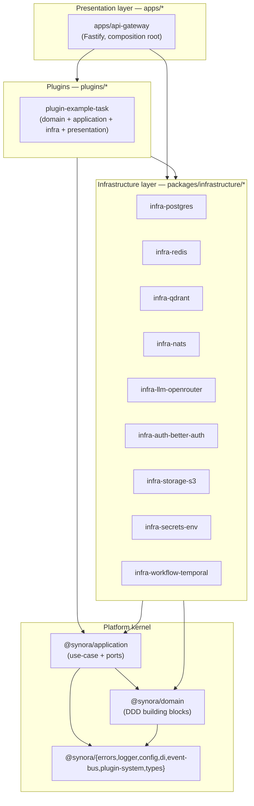

# Synora Architecture

Synora is a **provider-agnostic, domain-independent AI platform** — the foundation future
AI products at Synora are built on top of, not a product itself. This directory is the
system of record for every significant architectural decision behind that foundation.

## How to read this

- **Topic docs** (`01-*.md` through `15-*.md`) explain _how a concern works today_ —
  read these to understand the system.
- **`decisions/ADR-*.md`** explain _why it works that way instead of some other way_ —
  read these to understand the trade-offs and alternatives considered. New ADRs are
  numbered sequentially and are never edited after merge (a changed decision gets a new
  ADR that supersedes the old one).

## System shape

Dependencies only point inward/rightward in that diagram — see
`03-service-boundaries.md` for the enforced rule and `ADR-0002` for how it's enforced.

## Topic docs

| #   | Doc                                                          | Covers                                             |
| --- | ------------------------------------------------------------ | -------------------------------------------------- |
| 01  | [clean-architecture](01-clean-architecture.md)               | The four layers and the dependency rule            |
| 02  | [monorepo-structure](02-monorepo-structure.md)               | pnpm workspaces + Turborepo, folder layout         |
| 03  | [service-boundaries](03-service-boundaries.md)               | What can depend on what, and how it's enforced     |
| 04  | [dependency-injection](04-dependency-injection.md)           | `@synora/di`, tokens, the composition root         |
| 05  | [configuration-system](05-configuration-system.md)           | `@synora/config`, `.env.example`, secrets          |
| 06  | [plugin-architecture](06-plugin-architecture.md)             | `@synora/plugin-system`, `Plugin`, `PluginContext` |
| 07  | [event-driven-architecture](07-event-driven-architecture.md) | `DomainEvent`, `EventBus`, in-memory vs NATS       |
| 08  | [domain-layer](08-domain-layer.md)                           | `@synora/domain`                                   |
| 09  | [application-layer](09-application-layer.md)                 | `@synora/application`, ports, use cases            |
| 10  | [infrastructure-layer](10-infrastructure-layer.md)           | `packages/infrastructure/*` adapters               |
| 11  | [presentation-layer](11-presentation-layer.md)               | `apps/api-gateway`                                 |
| 12  | [coding-standards](12-coding-standards.md)                   | Naming, imports, TS config, lint/format            |
| 13  | [error-handling-standards](13-error-handling-standards.md)   | `AppError`, `DomainError`, `Result`                |
| 14  | [logging-standards](14-logging-standards.md)                 | `@synora/logger`, correlation ids, redaction       |
| 15  | [documentation-standards](15-documentation-standards.md)     | READMEs, ADRs, TSDoc                               |

## Decision records

| ADR                                                             | Decision                                                                  |
| --------------------------------------------------------------- | ------------------------------------------------------------------------- |
| [0001](decisions/ADR-0001-monorepo-tooling.md)                  | pnpm workspaces + Turborepo                                               |
| [0002](decisions/ADR-0002-layering-and-boundary-enforcement.md) | Layering enforced via package deps + TS project references + ESLint       |
| [0003](decisions/ADR-0003-feature-first-within-plugins.md)      | Feature-first inside plugins, layer-first at the platform kernel          |
| [0004](decisions/ADR-0004-custom-di-container.md)               | Custom minimal DI container over InversifyJS/tsyringe/awilix              |
| [0005](decisions/ADR-0005-plugin-architecture.md)               | Plugin model: manifest-free `Plugin` + `PluginContext` + `PluginRegistry` |
| [0006](decisions/ADR-0006-event-bus-design.md)                  | `EventBus` port, in-memory default, NATS in production                    |
| [0007](decisions/ADR-0007-configuration-system.md)              | zod-validated config mirroring `.env.example`                             |
| [0008](decisions/ADR-0008-error-handling-strategy.md)           | `AppError` hierarchy + `Result<T,E>`                                      |
| [0009](decisions/ADR-0009-logging-standard.md)                  | pino-backed structured logging + `AsyncLocalStorage` correlation ids      |
| [0010](decisions/ADR-0010-orm-choice.md)                        | Drizzle ORM over Prisma/TypeORM/Kysely                                    |
| [0011](decisions/ADR-0011-provider-adapter-strategy.md)         | Ports own by application layer, one adapter per `.env.example` default    |
| [0012](decisions/ADR-0012-testing-strategy.md)                  | Vitest + fakes over mocks + scoped-out live-infra integration tests       |
